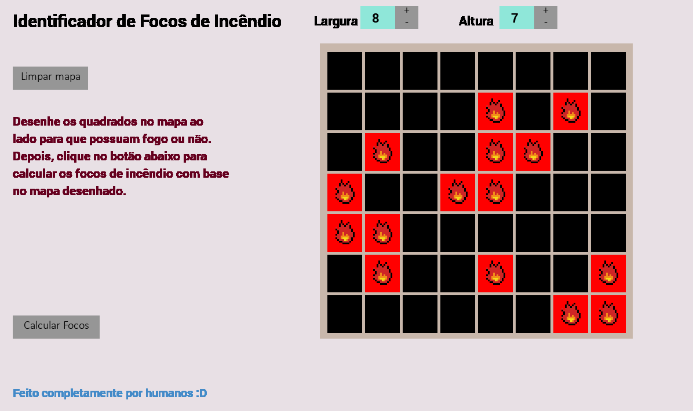
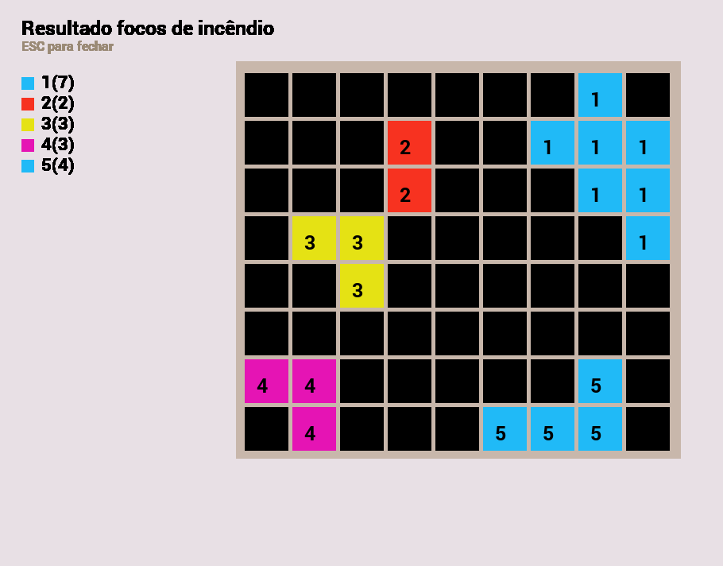

## Identificador Focos de Incêndio
Este é um programa feito para a disciplina de Matemática para Computação do 2° semestre da Fatec.  
Ele tem o objetivo de calcular focos de incêndio com base no input do usuário sobre um mapa que pode ser personalizado com os formatos de fogo que ele quiser.  

 

### Instruções para uso
1. Clone o projeto na sua máquina digitando em um terminal: `git clone https://github.com/HeyLavenderBee/python-fire-recursion` (garanta que o Git esteja instalado).
2. Navegue pelo terminal até a raiz do projeto, e adicione as dependências com o seguinte comando: `python -m pip install pygame_ce pygame_widgets`.
    - Caso queira utilizar um **venv**, siga esses passos:
        1. Digite no terminal, na raiz do projeto: `python -m venv env`.
        2. Depois de ter criado as pastas necessárias no diretório `env/`, execute o seguinte comando: `env/Scripts/activate`. Isso ativará o ambiente virtual.
        3. Depois, pode executar o mesmo comando indicado no segundo passo: `python -m pip install pygame_ce pygame_widgets`.
3. Agora, é só rodar o projeto desta forma: `py game.py` ou `python game.py`. Isso abrirá a janela principal, e você pode testar à vontade :)

 

---

 

### Imagens do projeto
O projeto é simples, sendo composto de apenas suas telas, uma para o input de fogos do usuário, e a outra com o resultado dos focos de incêndio gerados.

 

---

 

Feito completamente por humanos :)

